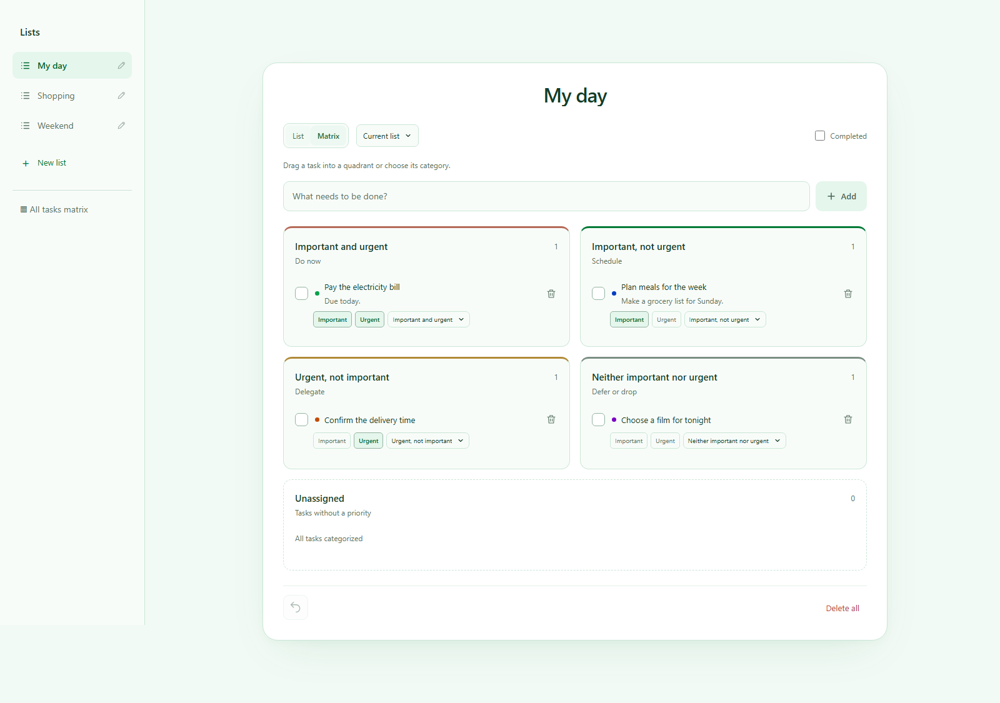

# Quiet List

A focused task workspace built with **React 19, TypeScript, and Vite**. Organize separate lists, write rich task notes, and prioritize work with an Eisenhower matrix.



## Features

- Independent task lists with inline renaming and a live task draft as you type.
- List and matrix views, priority filters, drag-and-drop categorization, and a combined matrix across lists.
- Task completion, per-list undo, and confirmation before clearing a list.
- Rich notes powered by Tiptap: headings, links, code, highlights, nested checklists, and a slash command menu.
- A shared color palette with custom colors and contextual editing.
- Browser persistence with validation and migration of older task data.
- Responsive layouts, keyboard-operated menus, accessible control labels, and reduced-motion support.

## Run locally

Use **Node.js 24 or newer**. A `.nvmrc` file is included.

```sh
npm ci
npm run dev
```

Open `http://127.0.0.1:5181/`. Vite updates the same tab while you edit the source.

```sh
npm run build
npm run preview
```

The production build is written to `dist/`. It can be hosted by any static hosting service. No environment variables or backend are required.

## Architecture

```text
src/
  components/       Task rows, sidebar, composer, matrix, and dialogs
  domain/           Task types, pure reducers, priority rules, storage boundary
  hooks/            Workspace state, persistence, and undo coordination
  App.tsx           View composition and application interactions
  RichDescription.tsx  Lazy-loaded Tiptap editor
  ColorPalette.tsx  Shared palette and contextual color controls
  CategorySelect.tsx   Keyboard-accessible category popover
```

### Design decisions

**Pure domain logic.** Task history and workspace changes are separate from React, so migration and undo behavior can be tested without rendering the UI. Unchanged or invalid actions do not create undo entries.

**One source of truth.** Matrix cards reference their original tasks rather than copying them. Editing or dragging a card updates the source list. The combined matrix coordinates undo across lists in the order changes were made.

**Validated persistence.** Stored JSON is treated as unknown data. Invalid records and duplicate IDs are filtered; legacy tasks are migrated. Only current list data is persisted, not undo snapshots. Existing storage keys are retained to preserve earlier installations.

**Editor isolation.** Task dialog changes remain local until Save. The editor is loaded with `React.lazy` only when task details are opened, keeping its dependencies out of the initial application chunk.

**Native interaction where useful.** The editable title uses normal text-input caret placement, task dialogs use the native dialog element, and category menus use popovers with explicit keyboard navigation.

## Quality checks

```sh
npm run check          # TypeScript, ESLint, formatting, unit tests, build
npx playwright install chromium
npm run test:e2e       # Desktop and mobile browser scenarios
```

Unit tests cover undo, list isolation, priority classification, migration, malformed storage, and serialization. Browser tests cover task CRUD, list renaming, completion, rich notes, confirmation, matrix updates, palette dismissal, and responsive layout.

GitHub Actions runs the same checks on pushes and pull requests and retains Playwright traces if a browser test fails.

Other commands:

```sh
npm run test:watch
npm run format
```

## Scope

This is a frontend application with local browser storage. Data is specific to the browser and is not synchronized between devices. Authentication, a backend API, and collaborative editing are outside the current scope. Clearing browser storage removes saved lists and tasks.

The screenshot uses demonstration data, not personal tasks.
